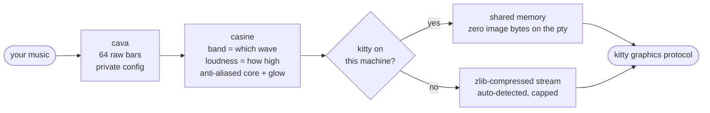

Uploading demo-small.mp4…


<div align="center">

# casine

#### audio-reactive sine waves for the [kitty](https://sw.kovidgoyal.net/kitty/) terminal

*eight glowing waves that listen to whatever you're listening to*


<!-- OPTIONAL demo (skip this whole block if you don't want it).
     The easiest way is a VIDEO, not a GIF:
       1. record your screen while casine plays music (any screen recorder,
          keep it under 10 MB; terminal recorders like asciinema can't
          capture kitty graphics)
       2. open README.md on github.com, click the pencil icon to edit
       3. drag the video file into the edit box - GitHub uploads it and
          inserts the link for you; put that link where the  line is,
          delete this comment, commit. -->


<sub>8 frequency bands &nbsp;&middot;&nbsp; 60 fps &nbsp;&middot;&nbsp; one terminal</sub>

</div>

---

## What is this?

No browser tab. No desktop app. Your music visualizer lives where you already
live: the terminal.

[cava](https://github.com/karlstav/cava) already knows how loud your music is,
band by band. casine turns every band into a travelling sine wave:

> **band** &nbsp;&rarr;&nbsp; *which wave moves*
> **loudness** &nbsp;&rarr;&nbsp; *how high it moves*

These are not character cells — casine paints real, anti-aliased pixels through
the kitty graphics protocol: crisp 2 px cores with a soft gaussian glow, one
hue per band, blended from cyan all the way to pink.

## Why you'll like it

- **Pixel-exact** lines and glow — not blocky ASCII bars
- **Auto-gain**, so the treble dances just as hard as the bass
- **Time-based motion** (attack / release / softness) — the same feel at any fps
- **Adaptive quality** — trades resolution *before* frame rate, and climbs back
  on its own when there is headroom
- **Shared-memory transport** when kitty runs on this machine — zero image
  bytes cross the pty
- **Non-invasive** — your existing cava setup is never touched; casine ships a
  private config

## Quick start

| need | why | check with |
| --- | --- | --- |
| [kitty](https://sw.kovidgoyal.net/kitty/) | the only terminal casine paints in | `kitty --version` |
| [cava](https://github.com/karlstav/cava) | the loudness source | `command -v cava` |
| python3 (3.6+) with numpy | the renderer | `python3 -c 'import numpy'` |
| PulseAudio or PipeWire (`pipewire-pulse`) | the sound cava listens to | `pactl info` |

Any distro works. On Arch, the whole menu is
`sudo pacman -S kitty cava python-numpy`.

```bash
git clone https://github.com/Zen-hue50/Casine
cd Casine
./install.sh
```

The installer checks your dependencies, installs the command as `casine` (from
`casine.py`) and drops the configs into `~/.config/casine/` — your own cava
config and existing casine settings are never overwritten.

Then, inside kitty:

```bash
casine
```

Press <kbd>q</kbd> or <kbd>Esc</kbd> to quit.

That's the whole UI. The rest is watching.

## Make it yours

Everything lives in `~/.config/casine/casine.ini` — every key is documented
inline in the file itself. The ones you'll reach for first:

| key | default | what it does |
| --- | --- | --- |
| `[waves] count` | `8` | how many frequency bands become waves |
| `[waves] colors` | cyan to pink | the palette, blended across the waves |
| `[audio] sensitivity` | `1.4` | higher = more punch, reacts to quieter sound |
| `[audio] auto_gain` | `true` | treble moves as much as bass |
| `[shape] center` | `0.5` | vertical position of the waves |
| `[shape] max_amplitude` | `0.34` | wave height at full volume |
| `[shape] speed_boost` | `1.5` | waves travel faster when it gets loud |
| `[look] glow_strength` | `0.30` | `0` = pure lines, no glow |
| `[look] thickness` | `2.0` | line width in pixels |
| `[motion] release_ms` | `320` | how slowly the waves settle back |
| `[render] render_scale` | `1.0` | 1.0 = pixel-exact; lower it on weak CPUs |

**Recipes**

> **Bass should hit harder** — `[audio] sensitivity = 2.0`

> **Lava-lamp mode** — `[motion] release_ms = 800`, `softness_ms = 120`

> **Pure wireframe, no glow** — `[look] glow_strength = 0`, `core_white = 0.4`

> **Running on a potato** — `[render] render_scale = 0.75`, and let
> `adaptive = true` handle the rest

<details>
<summary><b>Every knob, for the curious</b></summary>

| section | key | default | meaning |
| --- | --- | --- | --- |
| waves | `phase_spread` | `1.7` | phase offset between the waves |
| audio | `gain_memory` | `6.0` | seconds the auto-gain remembers a loud peak |
| audio | `noise_floor` | `0.03` | ignore levels below this |
| audio | `peak_mix` | `0.5` | 0 = band average, 1 = band peak |
| shape | `idle_amplitude` | `0.010` | the sway when everything is silent |
| shape | `bass_cycles` / `treble_cycles` | `1.0` / `4.5` | wavelengths across the screen |
| shape | `bass_speed` / `treble_speed` | `0.7` / `2.2` | travel speed of each end |
| shape | `max_slope` | `1.5` | limits steepness — treble stays shorter |
| shape | `edge_power` / `edge_fade` | `1.3` / `0.7` | how softly waves taper to the edges |
| look | `core_white` | `0.22` | the soft light in the centre of each line |
| look | `glow_width` | `11.0` | glow radius in pixels |
| look | `min_visibility` | `0.30` | brightness of silent waves |
| motion | `attack_ms` | `45` | how quickly waves rise |
| motion | `softness_ms` | `55` | rounds off sudden jumps — more is more liquid |
| render | `fps` | `60` | target frame rate |
| render | `adaptive` | `true` | auto-lower scale, then fps, when frames overrun |
| render | `fallback_scale` / `fallback_fps` | `0.6` / `30` | caps for the compressed fallback (e.g. SSH) |

</details>

## Under the hood

One commented Python file. Some things it does to stay smooth at 60 fps:



- **A dedicated writer thread owns the terminal** — rendering never blocks on a
  busy kitty, stale frames are dropped (conflation) and drawing pauses
  (backpressure); keys stay responsive, no "app not responding"
- **One vectorised numpy pass** computes the geometry of every band; every
  scratch buffer is reused across frames instead of being re-allocated 60
  times a second
- **The garbage collector is switched off while running** — per-frame objects
  are refcounted, so no GC pause can land in the middle of a frame
- **Drift-corrected frame pacing** — skipped frames donate their elapsed time
  to the next one, so wave speed stays exact
- **Adaptive quality** — if frames overrun their budget, casine first lowers
  `render_scale`, then the frame rate, and climbs back up automatically; it
  tells you what it settled for when you quit

## Troubleshooting

| symptom | fix |
| --- | --- |
| `casine: requires the Kitty terminal` | run it *inside* kitty — casine paints pixels, not character cells |
| `casine: could not find cava in PATH` | install cava (see quick start) |
| `casine: missing ~/.config/casine/cava.conf` | re-run `./install.sh` — it ships the private config |
| waves flat and frozen | is anything actually playing? sanity-check cava alone: `cava -p ~/.config/casine/cava.conf` should print a stream of numbers that dance |
| "kitty did not confirm shared-memory images" on exit | normal over SSH — casine switched to the compressed fallback at reduced scale/fps, by design |
| CPU running hot | lower `[render] render_scale`, or drop `[waves] count` |

## Questions people ask

**Why kitty only?**
casine speaks the kitty graphics protocol — real pixel images, not text.
Other terminals speak other protocols (sixel, iterm), which casine does not
speak. PRs welcome.

**Does it touch my existing cava config?**
No. casine keeps a private config at `~/.config/casine/cava.conf` and runs
cava against it. Whatever you have in `~/.config/cava/` is never read or
written.

**Does it work over SSH?**
Yes, automatically: if kitty can't use shared memory (remote machine), casine
falls back to compressed images with capped scale and fps
(`fallback_scale`, `fallback_fps` in `[render]`).

**Wayland or X11?**
Either. casine only cares about kitty and your sound server (PulseAudio, or
PipeWire via `pipewire-pulse`).

## Uninstall

```bash
./install.sh uninstall           # remove the command, keep your tuned configs
./install.sh uninstall --purge   # also delete ~/.config/casine
```

## Credits & license

[cava](https://github.com/karlstav/cava) does the listening ·
[kitty](https://sw.kovidgoyal.net/kitty/) does the painting ·
casine glues them together — GPL-3.0, see [LICENSE](LICENSE)

<div align="center">
<sub>turn it up.</sub>
</div>
